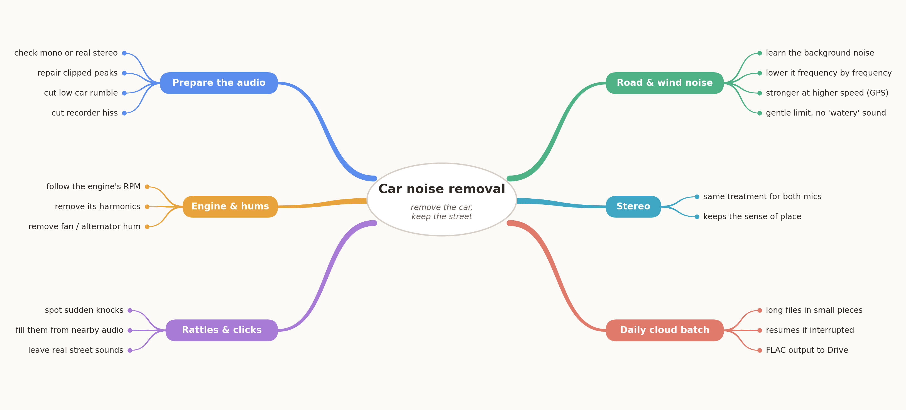

# carnoise

Cleans up street recordings made with microphones mounted on a car. The car itself is loud: the
engine, tyres on the road, wind hitting the mics, the mount rattling, a fan or alternator humming.
This removes as much of that as possible while leaving the street (people, traffic, birds, horns,
the general feel of the place) sounding natural.

It was written for the ensense dataset and runs as a batch job over the whole dataset, on Google
Colab or any machine with Python and FFmpeg.

This repo is the cleaned-up version of the original Colab notebook
(`ensense_denoise_carnoise_full_dataset.ipynb`). The processing is exactly the same. I checked that
it produces the same audio files and the same CSV logs, sample for sample, so you can pick up a
folder the notebook started and keep going with this.



## Setup

You need Python 3.10 or newer and FFmpeg (`apt-get install ffmpeg` on Linux/Colab,
`brew install ffmpeg` on a Mac).

```bash
pip install .
```

For development (adds pytest): `pip install -e ".[dev]"`

## Running it

The main use is processing the whole dataset. It reads `files.csv` from the data folder and writes
one cleaned FLAC per recording:

```bash
carnoise batch -c config/colab.toml
```

If it stops halfway (a Colab disconnect, for example), run the same command again. Files that are
already done get skipped.

A few other things you can do:

```bash
carnoise batch -c config/colab.toml --max-files 3    # quick test on 3 files
carnoise report -c config/colab.toml                 # how far along each unit is, and what failed
carnoise denoise recording.flac some_folder/ -o cleaned/   # just clean a few files
```

Or from Python:

```python
import soundfile as sf
from carnoise import denoise

audio, sr = sf.read("recording.wav")   # needs to be 48 kHz
cleaned, info = denoise(audio)
print(info)   # what it found: filter settings, clicks, how well it tracked the engine
```

On Colab, open `notebooks/colab_runner.ipynb`. It installs the package, runs everything and lets
you listen to the before/after.

## Settings worth knowing

Everything is in `config/colab.toml` with a comment next to it. The ones you're most likely to
touch:

- `floor_shift_db` controls how hard it works. The default is 0. Try -3 for more removal, or +3 if
  the street starts sounding thin or watery.
- `high_pass_hz` and `low_pass_hz` are picked automatically per file. You can force a number if
  you need to.
- `remove_tonal_lines` removes steady hums. Read the note about horns below before relying on it.
- `click_k` sets how sensitive the rattle repair is. Higher means it fixes fewer clicks.
- `other_sample_rates` decides what happens to files that aren't 48 kHz. By default they're
  converted. Set it to `"error"` to skip them instead, which is what the old notebook did.

## More docs

- [docs/algorithms.md](docs/algorithms.md) explains each processing step and its numbers.
- [docs/architecture.md](docs/architecture.md) shows how the code is organised and why.
- [docs/operations.md](docs/operations.md) covers running it, what ends up in the output folder,
  and what to do when something fails.

## Tests

```bash
pytest
```

This takes about a minute. It uses generated test audio, so no real recordings are needed. It also
does a small end-to-end batch run, which needs FFmpeg installed.

## Things it doesn't do well yet

- **Car horns get quieter.** The step that removes fan and alternator hum also catches anything
  with a steady pitch, so horns and some alarms lose about 12 dB, even short ones. Birds, sirens
  and voices are fine because their pitch moves. If horns matter for your use, set
  `remove_tonal_lines = false` (you'll keep some hum). There's a proper fix planned; see
  [docs/algorithms.md](docs/algorithms.md#2b-tonal-lines).
- Road and wind noise sit in the same range as real street sound, so they're turned down, not
  removed.
- Where a recording clipped badly, the lost part can only be guessed.
